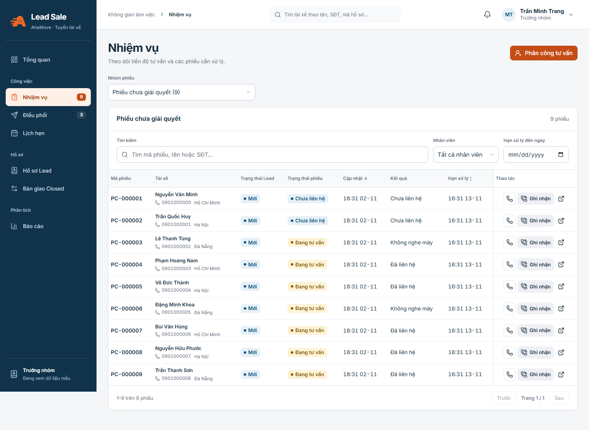

# Lead Sale

Hệ thống quản lý Lead tài xế: tiếp nhận hồ sơ, phân công tư vấn, chăm sóc, lịch hẹn, bàn giao Closed, báo cáo và quản trị người dùng.

Frontend dùng React, TypeScript và Vite. Backend dùng Supabase Auth, PostgreSQL/RLS và Storage. Source ứng dụng nằm trong **`app/`**.

## Chạy nhanh bản demo

Cài **Node.js 24 trở lên**, tải source về và chạy:

```sh
cd app
npm ci
npm run dev:demo
```

Mở http://127.0.0.1:5173. Demo dùng dữ liệu mẫu, không cần `.env.local` hay tài khoản Supabase. Bấm **Tài khoản** ở góc trên để chọn Quản trị viên, Tiếp nhận hồ sơ, Trưởng nhóm hoặc Telesale.

Nếu tải ZIP, giải nén trước khi mở terminal. Hướng dẫn kết nối dữ liệu thật, cấu hình và dựng backend riêng: **[Hướng dẫn nhận source](docs/18-huong-dan-nhan-source.md)**.

## Cấu trúc chính

| Thư mục | Nội dung |
| --- | --- |
| `app/src/components/lead-sale/` | Giao diện và nghiệp vụ Lead Sale |
| `app/backend/supabase/` | Schema và migration đang dùng |
| `app/tests/` | Kiểm thử SQL và workflow |
| `app/e2e/lead-sale/` | Kiểm thử trình duyệt demo |
| `docs/` | Đặc tả, hướng dẫn và lịch sử kiểm chứng |
| `app/src/components/atomic-crm/`, `app/supabase/` | Source Atomic CRM giữ để tham khảo |

Không dùng migration trong `app/supabase/` cho Lead Sale. Mô hình hiện tại vẫn giữ lớp tương thích cho RPC; xem [tài liệu chuyển bảng](docs/17-chuyen-bang-supabase-theo-tai-lieu.md).

## Kiểm tra source

Chạy tại `app/`:

```sh
npm run typecheck
npm run lint
npm test
npm run build
```

Kiểm thử trình duyệt: cài Chromium bằng `npx playwright install chromium`, rồi chạy `npm run test:e2e`. Đây là kiểm thử local/demo. Tài liệu ghi nhận các lần triển khai trước không xác nhận trạng thái production hiện tại.

## Thay đổi menu ngày 02/11/2026

- Quản trị viên: bỏ mục **Tài khoản của tôi** ở thanh điều hướng. Vẫn vào trang tài khoản bằng **Tài khoản → Đổi mật khẩu**.
- Tiếp nhận hồ sơ: bỏ mục **Lịch hẹn** khỏi thanh điều hướng. Trưởng nhóm và Telesale vẫn có mục này.

## Giao diện cập nhật ngày 02/11/2026

Điều hướng, bảng, bộ lọc và form đã được chỉnh đồng bộ. Trên điện thoại, hồ sơ/tài khoản/nhiệm vụ hiển thị thành từng bản ghi; thao tác không che tên và số điện thoại. Xem [thay đổi và kết quả kiểm tra UI/UX](docs/19-cap-nhat-ui-ux-2026-11-02.md) cùng [quy tắc thiết kế](DESIGN.md).



## Tài liệu

- [Hướng dẫn nhận source và chạy trên máy mới](docs/18-huong-dan-nhan-source.md)
- [Đặc tả nghiệp vụ BA](docs/09-dac-ta-nghiep-vu-ba.md)
- [Kiến trúc, API và vận hành](docs/06-ban-giao-va-van-hanh.md)
- [Form tài xế tự đăng ký](docs/11-form-tai-xe-tu-dang-ky.md)
- [Triển khai Vercel — lịch sử và thao tác](docs/14-trien-khai-vercel.md)
- [Mô hình bảng Supabase và giới hạn tương thích](docs/17-chuyen-bang-supabase-theo-tai-lieu.md)

## Giấy phép và nguồn gốc

Phát triển từ [marmelab/atomic-crm](https://github.com/marmelab/atomic-crm), base tham khảo `b8e5e20c4dd4b9e440088621283849adf1e1839d`. Giữ [giấy phép gốc](app/LICENSE.md), attribution và [README Atomic CRM](app/README.atomic-crm.md).

Bản source không kèm cấu hình local, mật khẩu, khóa quản trị, dữ liệu runtime, dependencies hoặc bản build. Repo riêng tư yêu cầu quyền truy cập khi mở trên GitHub; người nhận ZIP có thể chạy demo theo hướng dẫn trên.
