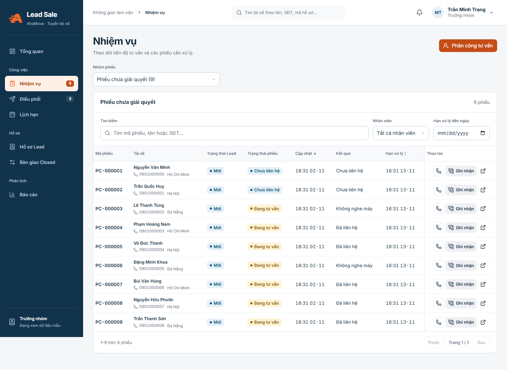

# Cập nhật UI/UX Lead Sale — 02/11/2026

Bản này cải thiện giao diện ứng dụng nội bộ, giữ nhận diện AhaMove cam–navy và các luồng nghiệp vụ hiện có. Không chạy migration, thay đổi dữ liệu hay triển khai production trong lần chỉnh này.

## Các thay đổi chính

- Điều hướng navy, vùng nội dung trắng trên nền xám; tiêu đề, nút chính, nhãn bộ lọc và thông tin phụ có phân cấp thống nhất.
- Khung nội dung, bảng, form, hộp thoại và phân trang dùng cùng nhịp khoảng cách. Sửa chữ số trang quá nhạt do dùng nhầm token nền làm màu chữ.
- Chia sẻ form tài xế thành thanh tiện ích gọn. Đường link mở theo yêu cầu; lỗi clipboard vẫn hiện link để người dùng sao chép thủ công.
- Nhiệm vụ gộp tên/SĐT/thành phố vào một ô tài xế. Màn hẹp dùng bộ chọn nhóm phiếu thay thanh nhóm kéo ngang.
- Trên điện thoại, hồ sơ, người dùng và nhiệm vụ hiển thị từng bản ghi có nhãn. Tên/SĐT, kết quả, hạn xử lý và nút thao tác không che nhau. Bộ chọn sắp xếp giữ đủ chiều tăng/giảm của thời điểm cập nhật và hạn xử lý.
- Ở màn hình trung gian, bảng nhiều cột cuộn trong vùng riêng; bỏ cột thao tác dính để không đè dữ liệu, kèm chỉ dẫn cuộn ngang.
- Menu di động có nút đóng, Escape, giữ focus trong menu, trả focus về nút mở và ngăn tab vào điều hướng đang ẩn. Có hỗ trợ giảm chuyển động.
- Zoom báo cáo tham gia bố cục thật; in luôn trở về tỷ lệ 100%.
- Giữ yêu cầu menu: Admin không có Tài khoản của tôi ở thanh điều hướng, vẫn vào qua Đổi mật khẩu; Tiếp nhận không có Lịch hẹn trong menu.

## Hình minh họa bằng dữ liệu mẫu

[Xem nhiệm vụ trên điện thoại](ui-20261102/mobile-tasks.png). Ảnh dùng dữ liệu demo, không phải bằng chứng dữ liệu production.

## Kiểm chứng

| Phạm vi | Kết quả |
| --- | --- |
| TypeScript và production build | Đạt; vẫn có cảnh báo kích thước bundle |
| ESLint ứng dụng | Đạt |
| Vitest local/PGlite | 125/125 đạt |
| Playwright demo hiện có | 18/18 đạt |
| Rà các màn chính và trạng thái bằng Chromium | 21 ảnh ở 1440, 1024 và 390 px; không tràn ngang toàn trang, không có pageerror |
| Menu và điều hướng | Kiểm tra Tab trong menu, Escape/trả focus, đổi nhóm phiếu và đường dẫn Đổi mật khẩu đạt |
| Nhiệm vụ trên điện thoại | Kiểm tra tên/SĐT nằm trong màn hình, nút thao tác dưới thông tin, sắp xếp và mở Ghi nhận đạt |
| Zoom báo cáo | Kiểm tra 90%, 100%, 110% thay đổi kích thước vùng bố cục đạt |
| Rà giao diện độc lập | Kết luận ship ở phạm vi giao diện/ảnh đã kiểm tra; lỗi che thông tin trên nhiệm vụ mobile đã sửa và đối chiếu lại |

Máy kiểm tra dùng Node 22.21.0 với cờ tương thích khi chạy Playwright; môi trường cài đặt được hỗ trợ trong package vẫn là Node 24+. Kiểm chứng là local/demo, không thay thế nghiệm thu nghiệp vụ production hay kiểm toán accessibility toàn bộ ứng dụng. Bảng nhiều cột ở kích thước trung gian vẫn có cuộn ngang có chủ đích.

## Tiếp tục phát triển

Đọc `DESIGN.md` ở gốc repo để giữ token, bố cục responsive và trạng thái tương tác nhất quán. Hướng dẫn nhận source/chạy demo nằm ở [tài liệu 18](18-huong-dan-nhan-source.md).
