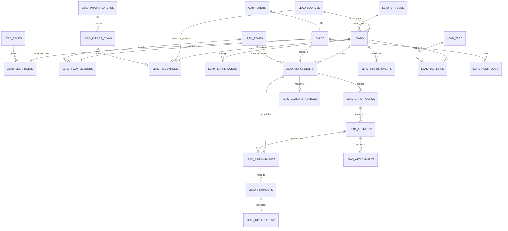

# Thiết kế dữ liệu và hợp đồng API dự thảo

Thuộc [đặc tả bước 1](../05-dac-ta-buoc-1.md). **Toàn bộ bảng mới, endpoint, payload và ràng buộc dưới đây là thiết kế, chưa có trong DB/API chạy thật.** Các quy tắc D còn chờ xác nhận được nêu trong tài liệu chính. Không dùng tài liệu này làm bằng chứng đã triển khai.

## 1. Tận dụng base và quyết định kỹ thuật

| Quyết định | Căn cứ code | Hướng thực hiện và ảnh hưởng |
| --- | --- | --- |
| Giữ Supabase Auth + `sales` làm profile | `app/src/components/atomic-crm/providers/supabase/authProvider.ts`, `supabase.ts`; `app/supabase/schemas/01_tables.sql` | `sales.id` bigint là khóa actor/assignee; `sales.user_id` unique liên kết Auth UUID; giữ trigger đồng bộ profile nhưng rà cách bootstrap/quyền |
| Thêm vai trò nghiệp vụ | Base có `sales.administrator` boolean và `canAccess.ts` admin/user | `lead_user_roles` là nguồn quyền nghiệp vụ. Chỉ Admin/server đổi được. Đồng bộ administrator=true đúng khi role=admin bằng giao dịch server để các helper cũ không thành nguồn quyền thứ hai |
| Tạo resource Lead riêng | contacts có phone_jsonb, sales_id; tasks gắn contact; deals có pipeline/amount. Module `lead-sale/types.ts` đã tách Lead/Assignment/Activity | Tạo `leads` và `lead_*`; không đổi contacts/deals/tasks, không copy dữ liệu Lead vào các bảng đó. Tái sử dụng pattern UI/list/form/Auth/client, thêm repository/provider Lead Sale |
| Hạn chế API cũ | `05_policies.sql` cho authenticated đọc/ghi contacts/notes/tasks rộng; sales đọc toàn cục | Không coi policy cũ đáp ứng quyền mới. Rà quyền đọc profile/roster và các function admin cũ. Luồng Lead Sale không gọi global_search/merge_contacts để xử lý hồ sơ Lead |
| Storage riêng cho bằng chứng | Base uploadToBucket trong dataProvider có đường getPublicUrl | Thiết kế bucket riêng không public, truy cập theo Lead/assignment còn quyền; upload không tự tạo quyền đọc. Không dùng URL public cũ cho recording/chat |
| Ghi nghiệp vụ qua command | Demo dùng applyCommand và localStorage | Các command chuyển sang transaction backend; frontend chỉ gửi ý định và expected_version. Không cho client UPDATE trạng thái trực tiếp bỏ qua lịch sử/quyền |

Bootstrap Admin phải bằng seed/migration hoặc quy trình quản trị kiểm chứng; đăng ký user mới không tự nhận Admin. `sales.disabled` là nguồn trạng thái tài khoản. Rà cache current_sale trong Auth provider: cache chỉ phục vụ UI, không có quyền bỏ qua kiểm tra disabled/role/team tại DB. Giữ thông báo MIT và provenance của base.

Đề xuất dùng một nhóm mặc định khi demo nhưng mô hình hỗ trợ nhiều nhóm. Một Telesale/trưởng nhóm có một membership hoạt động; chuyển nhóm giữ ảnh chụp team trên assignment và audit. Dữ liệu localStorage hiện tại không tự đồng bộ vào DB thật; chỉ import qua công cụ có validation và ánh xạ ID nếu sau này có yêu cầu.

## 2. ERD dự thảo



Các bảng kỹ thuật command_requests/job_runs và quan hệ actor/creator bổ sung được mô tả bên dưới để ERD chính không quá rối. Attachment thuộc activity; có thể gắn cả activity ghi nhận hồ sơ/bằng chứng trạng thái nếu cần, nhưng không gán file trôi nổi không có Lead và quyền.

## 3. Bảng và trường chính

Tên bảng dự kiến ở schema public để dùng provider của base; các hàm quyền/log nội bộ có thể ở private theo pattern repo. UUID dùng cho các bảng nghiệp vụ mới, code dễ đọc (`LEAD-…`, `PC-…`) là unique riêng do server sinh; không dùng UUID rút 8 ký tự làm khóa duy nhất. Mọi timestamp là timestamptz; mọi bảng nghiệp vụ có created_at/updated_at theo nhu cầu, version bigint để kiểm soát sửa đồng thời.

| Bảng | Trường/quan hệ chính | Ràng buộc và mục đích |
| --- | --- | --- |
| `sales` (đã có) | id, user_id, first_name, last_name, email, disabled, administrator | Giữ unique user_id; actor lấy từ Auth → sales. Không để client sửa disabled/administrator |
| `lead_roles` | code PK, label | 5 mã admin/intake/leader/telesale/viewer; role policy không do client tự thêm |
| `lead_user_roles` | sales_id PK/FK sales, role_code FK | Một role/user (D-06); không có role hoặc disabled thì không được vào nghiệp vụ |
| `lead_teams` / `lead_team_members` | team id/code/name/active; membership sales_id PK, team_id, joined_at | Một nhóm/user; chỉ leader/telesale được membership hoạt động; lịch sử chuyển nằm trong audit và team snapshot phiếu |
| `lead_sources` | id, code unique, name, active | Ngưng dùng nguồn không làm mất dữ liệu cũ; nguồn mới chọn phải active |
| `lead_statuses` | code PK, label, display_order | Mã cố định New/Activated/Onboarded/Closed. Admin sửa nhãn/thứ tự; thêm/xóa mã hoặc sửa workflow phải qua thay đổi nghiệp vụ/migration |
| `leads` | id, code, full_name, phone_original, phone_normalized, city, vehicle_type, first_received_at, source_id, status_code, activated_at, onboarded_at, archived_at/by, created_by, version | Unique phone_normalized toàn bảng, kể cả lưu trữ. Status FK. Vehicle Van/Motorbike. Milestone không suy từ phiếu Closed |
| `lead_receptions` | id, lead_id, source_id, channel, received_at, received_by, kind(new/repeat), note, import_row_id nullable, created_at | Mỗi lần tiếp nhận một bản ghi; source_id là nguồn lần này, khác nguồn đầu của Lead nếu tiếp nhận lại. Không sửa ngày/nguồn đầu vì nhận lại |
| `lead_intake_queue` | id, lead_id, last_reception_id, state, assigned_assignment_id nullable, resolution_reason, version | Unique một pending/Lead; khi giao xong state=assigned. Sự kiện trùng khi đang có phiếu dùng state/result already_assigned, không tạo pending mới |
| `lead_assignments` | id, code, lead_id, assignee_id FK sales, team_id FK, assigned_by, created_at, accepted_at/by, updated_at, expires_at, status, solved_reason, closed_at/by, close_reason, previous_assignment_id, current_round_id, version | Unique chưa Closed theo lead_id; FK/composite key bảo đảm current round thuộc chính phiếu. Hạn không sửa bằng update thường |
| `lead_care_rounds` | id, assignment_id, round_no, opened_at/by, reason | Unique(assignment_id, round_no); round 1 lúc tạo; mở lại Solved tạo round tiếp, không đổi expires_at |
| `lead_activities` | id, lead_id, assignment_id, care_round_id, actor_id, kind(call/message/appointment_result), channel(phone/zalo/manual), occurred_at, outcome, decision, reason, note, appointment_id nullable, supersedes_activity_id nullable, created_at | Lưu lịch sử; correction chỉ rõ bản ghi thay thế, ai/lý do. FK/composite ràng buộc Lead/phiếu/round/lịch nhất quán |
| `lead_appointments` | id, lead_id, assignment_id, care_round_id, activity_id nullable, scheduled_at, place, status, result_at/by, cancellation_reason, previous_appointment_id nullable, version | Một scheduled/phiếu; scheduled/attended/missed/cancelled. Hẹn lại/chuyển người tạo lịch mới tham chiếu cũ; không ghi đè mất lịch sử |
| `lead_attachments` | id, activity_id, lead_id, assignment_id, uploaded_by, object_path unique, original_name, mime_type, byte_size, state(pending/ready/rejected), created_at | Metadata server gắn activity; file không public; giới hạn loại/dung lượng cấu hình kỹ thuật trước hiện thực. Chỉ ready được dùng làm bằng chứng |
| `lead_status_events` | id, lead_id, from_status, to_status, occurred_at, recorded_at, actor_id, reason_code, evidence_text/ref, attribution_assignment_id nullable | Append-only qua command, ghi mốc chuyển và căn cứ. attribution lúc xảy ra sự kiện phục vụ truy vết, không tự thành cách quy công KPI snapshot |
| `lead_closure_reviews` | id, assignment_id unique, lead_id, closed_business_date, state(pending/reviewed/needs_info), result, reviewed_by/at, reason, lead_version_at_review, replacement_assignment_id nullable | Một bàn giao/phiếu; chuyển người đánh dấu no_change/transferred. Re-review giữ audit; không lùi trạng thái hồ sơ vì phiếu cũ |
| `lead_tags` / `lead_tag_links` | tag id/name/color/active; PK(lead_id, tag_id) | Nhãn chuẩn hóa, không nhân đôi theo dấu cách/hoa thường; ngưng dùng giữ liên kết lịch sử |
| `lead_import_batches` / `lead_import_rows` | batch file_name, uploaded_by, format, created_at, state, totals; row batch_id, row_no, normalized_data, validation_state, errors, resolution, lead_id/reception_id | Unique(batch_id,row_no); preview và commit từng dòng với khóa chống trùng; rows trùng cần chọn cách bổ sung trước commit |
| `lead_reminders` | id, appointment_id, kind, recipient_id, due_at, state, sent_at, error | Unique(appointment_id,kind,recipient_id), mốc/server theo D-10; cập nhật lịch hủy reminder chờ |
| `lead_notifications` | id, recipient_id, kind, entity_id, dedupe_key unique, created_at, read_at, payload | Chỉ người nhận đọc/đánh dấu đã đọc. Payload tối thiểu, không nhúng SĐT/recording/ghi chú; bấm vào kiểm tra lại quyền hiện tại |
| `lead_audit_logs` | id, at, actor_user_id/sales_id nullable, actor_type(user/job), action, entity_type/id, before, after, reason, request_id | Server ghi cùng transaction; actor job không giả là Admin; không ghi password/token hoặc nội dung binary vào audit |
| `lead_command_requests` (nội bộ) | actor key, command, idempotency_key, payload_hash, result_ref | Unique(actor,command,key); cùng key/payload trả lại kết quả, khác payload báo conflict; không lưu access token |
| `lead_job_runs` (nội bộ) | job_name, business_key, started_at, finished_at, state, error, attempts | Theo dõi chạy/bù; ngày digest dùng UTC+7. Một job run có thể xử lý nhiều entity; chống trùng cuối cùng vẫn ở unique dữ liệu đích |

Các FK lịch sử dùng RESTRICT hoặc cơ chế bảo toàn tương đương; xóa Auth user không cascade mất hồ sơ/phiếu/audit. V1 dùng vô hiệu hóa tài khoản. Nếu hỗ trợ xóa Auth sau này, phải có thiết kế giữ actor lịch sử.

## 4. Từ điển/validation đề xuất — D-11

| Trường | Bắt buộc | Quy tắc |
| --- | --- | --- |
| Họ tên | Có | Trim, 2–120 ký tự; không tự tách thành first/last làm mất tên nguồn |
| SĐT | Có | Chấp nhận 0 + 9 chữ số hoặc +84/84 + 9 chữ số, bỏ dấu cách/dấu phân cách hợp lệ, chuẩn hóa về 10 chữ số 0…; lưu cả bản nhập. Không chấp nhận ký tự chữ bằng cách âm thầm xóa |
| Thành phố | Có | Trim, 1–120 ký tự; danh sách gợi ý, chưa có nguồn danh mục đủ để ép mọi thành phố vào 3 giá trị mẫu |
| Loại xe | Có | Mã Van/Motorbike; hiển thị tiếng Việt |
| Nguồn | Có | FK nguồn đang active cho lần tiếp nhận mới; nguồn đã ngưng vẫn đọc được và giữ trên hồ sơ cũ |
| Mã hồ sơ/ngày đầu/trạng thái đầu | Server | Khi tạo bình thường: mã sinh server, first_received_at=received_at lần đầu, status=New. Không cho payload tạo gán Activated trực tiếp |
| Reception received_at | Có, mặc định server now | Tiếp nhận có thể nhập thời điểm thực tế ≤ now, không trước ngày đầu với hồ sơ trùng; sửa dữ liệu ngày đầu phải là thao tác đính chính có audit, không qua import thường |
| Activity kind/channel/time/outcome | Có | Call→phone; message→zalo; appointment_result→manual. Thời điểm từ tạo phiếu đến hiện tại; phải thuộc round phù hợp, không backdate sang round đã đóng |
| Decision/Reason | Theo điều kiện | none/agreed/declined/hungup; none/no_need/busy/ineligible. Giá trị nguồn 0 → none. Khi chưa liên hệ được thì decision=none; khi declined thì reason khác none; ngoài declined thì reason=none |
| Activity note | Có | Nội dung/kết quả, trim không rỗng; giới hạn độ dài kỹ thuật thống nhất UI/DB trước hiện thực |
| Giờ/nơi hẹn | Khi đặt lịch | scheduled_at > now và < expires_at, nơi không rỗng; một scheduled/phiếu; activity tạo lịch có agreed |
| Căn cứ Activated/Onboarded | Có | Nội dung hoặc tham chiếu bằng chứng, occurred_at không ở tương lai; activated_at ≥ first_received_at; onboarded_at ≥ activated_at |

Kết quả liên hệ UI là giá trị suy ra: chưa có liên hệ→New, outcome=contacted→Đã gọi, no_answer/missed có số round, wrong_phone→Sai SĐT. Không lưu ba loại trạng thái chung một cột. Reason_disconnect/type/decision_time trong ảnh chưa có định nghĩa nên chưa thêm trường nghiệp vụ chỉ để giống ảnh.

## 5. Giao dịch, dữ liệu đồng thời và quyền

- **Tiếp nhận:** kiểm tra role; unique phone ở DB; nếu phát hiện trùng do race trả duplicate để mở hồ sơ, không tự merge thay người dùng. Ghi Lead/reception/queue/audit cùng transaction cho một dòng.
- **Giao/chuyển:** khóa hàng Lead và phiếu liên quan, kiểm tra phiên bản/quyền/assignee/team; xử lý phiếu hết hạn đang tồn tại; đóng cũ, hủy/mang lịch theo lựa chọn, tạo mới, queue và audit cùng transaction.
- **Tư vấn/lịch:** khóa phiếu/round/lịch, kiểm tra accepted/status/expiry, ghi Activity, lịch, bộ đếm suy ra, trạng thái và audit cùng transaction. Unique trên sự kiện missed ngăn một lịch bị đếm hai lần.
- **Expiry:** command từ chối nếu quá hạn dù trạng thái chưa Closed. Không hứa một transaction thất bại vẫn lưu được thao tác tự đóng trước đó; job độc lập hoặc command giao lại thành công mới ghi closure theo giao dịch của nó.
- **Số đếm:** activity/care round là nguồn đúng; có thể cache counters nhưng cập nhật trong cùng transaction và đối soát từ sự kiện hợp lệ, không cộng từ frontend.
- **RLS/ghi:** đọc theo [ma trận](01-quyen-va-workflow.md), view đọc phải giữ kiểm soát quyền của dữ liệu gốc. Chặn ghi trạng thái/actor/audit trực tiếp; nếu dùng hàm nâng quyền nội bộ phải tự kiểm tra session/role/scope, đặt phạm vi hàm rõ và không mở thực thi cho anon.
- **File:** khởi tạo pending upload có kiểm tra quyền; upload vào path gắn Lead/phiếu; finalize xác thực object thuộc phiên upload và activity đúng quyền. Dọn object mồ côi theo job. Quyền tải kiểm tra lại lúc yêu cầu; dùng URL ngắn hạn, không hứa thu hồi byte file đã tải hoặc URL đã phát trước khi hết hạn.
- **Import:** preview không giữ chỗ SĐT. Commit revalidate từng dòng; cho phép dòng hợp lệ thành công độc lập, trả kết quả từng dòng; mỗi dòng nguyên tử. Gửi lại commit không thêm reception event lần hai. Các chỉ tiêu tổng batch được tổng hợp từ rows, không tin tổng do client truyền.
- **Gửi lại command:** kiểm tra quyền hiện tại trước khi trả kết quả idempotency. Nếu actor đã bị tạm ngưng/chuyển quyền hoặc mất quyền hồ sơ, không phát lại payload cũ chứa dữ liệu nay bị chặn; vẫn giữ khóa để không tạo thao tác trùng.
- **Báo cáo:** RPC/view tổng hợp có phạm vi riêng, không cấp viewer quyền đọc bảng Lead để có biểu đồ; không trả raw ID/SĐT/notes qua JSON tổng hợp. Audit cũng không được dùng như đường đọc vòng qua Lead bị chặn.

## 6. Hợp đồng đọc API dự kiến

Phương thức/đường dẫn dưới đây là tên dự kiến để thống nhất thiết kế. Dùng Supabase client/provider của base; chưa tạo REST server riêng. `Bearer session` là phiên Auth; publishable key không thay quyền user. Đường đọc có thể hiện thực bằng resource/view/RPC tương đương, nhưng phải giữ payload/quyền và kiểm chứng lại khi viết API thật.

| Method / path dự kiến | Input | Output | Quyền và lỗi chính |
| --- | --- | --- | --- |
| GET `/rest/v1/leads` | select cho phép, filter phone/name/status/source/city/vehicle, sort, phân trang | Lead được phép đọc, count theo cùng bộ lọc | Admin/intake toàn cục; leader nhóm+hàng đợi; telesale được giao; viewer bị chặn |
| GET `/rest/v1/lead_assignments` | lead_id/assignee/status/team/hạn/nhóm nhiệm vụ, phân trang | Phiếu + trường đếm/round/acceptance | Ma trận phạm vi; sau hạn telesale không đọc phiếu cũ |
| GET `/rest/v1/lead_activities` | assignment_id, phân trang thời gian | Activity hợp lệ/correction trong phạm vi | Quyền hiện tại trên Lead/phiếu; không lọt note/file của người ngoài |
| GET `/rest/v1/lead_appointments` | trạng thái, khoảng giờ, assignee | Lịch trong phạm vi | Như workflow; viewer bị chặn |
| GET `/rest/v1/lead_intake_queue` | state, ngày tiếp nhận, phân trang | Hàng đợi mở/kết quả xử lý | Admin/intake; leader theo quy tắc HĐ |
| GET `/rest/v1/lead_closure_reviews` | ngày đóng, state, assignee, phân trang | Danh sách Closed và thông tin rà soát | Admin/intake; leader nhóm chỉ đọc |
| POST `/rest/v1/rpc/lead_report` | from_date, to_date, source/status/assignee/team filters | totals, funnel, by_source/status/member, applied_filters, metric_version | Phạm vi báo cáo riêng; không trả PII cho viewer/telesale lịch sử |
| GET `/rest/v1/lead_notifications` | người nhận lấy từ phiên, unread, phân trang | Thông báo cá nhân | User chỉ đọc thông báo chính mình |

Ngày lọc API báo cáo theo `YYYY-MM-DD` UTC+7; `from` inclusive, `to` inclusive ở UI chuyển thành exclusive đầu ngày kế tiếp trong truy vấn. Trả count nhất quán với danh sách và sort ổn định thêm id khi bằng timestamp. Kích thước trang/dung lượng import/file là cấu hình kỹ thuật, cần chốt và kiểm chứng ở bước hiện thực; chưa có SLA theo nguồn.

## 7. Hợp đồng command dự kiến

Các endpoint dưới đây đều **POST `/rest/v1/rpc/<tên>`**, trừ file Storage và Auth dùng client của base. Mọi command ghi có `request_id` (idempotency key), phiên user; khi sửa đối tượng hiện hữu có `expected_version`. Actor, team snapshot, mã và created_at lấy từ server; không nhận role từ client làm căn cứ.

| Tên dự kiến | Input chính | Output chính | Quyền/điều kiện |
| --- | --- | --- | --- |
| `lead_receive` | reception source/channel/received_at, Lead fields; existing_lead_id và selected_changes khi bổ sung | lead_id/code/version, reception_id, queue_result | Admin/intake; unique SĐT, validate/merge có chủ đích |
| `lead_update` | lead_id, expected_version, fields, reason | Lead mới/version | Admin/intake; source/ngày đầu/milestone không sửa qua fields thường |
| `lead_set_status` | lead_id, to_status, occurred_at, reason, evidence, expected_version | Lead, status_event, affected_assignment_ids | Admin/intake; đúng ma trận; activity/appointment bị tác động cùng transaction |
| `lead_archive` / `lead_restore` | lead_id, expected_version, reason | Lead/version | Admin/intake; archive khi không còn phiếu chưa Closed |
| `lead_assign` | queue_id, lead_id, assignee_id, expected_lead/queue_version | assignment/code, expires_at | Leader cùng nhóm/Admin; không trùng phiếu hiệu lực |
| `lead_accept_assignment` | assignment_id, expected_version | accepted_at, assignment/version | Chỉ assignee, trong hạn |
| `lead_transfer_assignment` | assignment_id, new_assignee_id, reason, appointment_action, expected_version | closed_old_id, new_assignment, replacement_appointment_id nullable | Leader cùng nhóm/Admin; chuyển khác người; D-05 chờ xác nhận |
| `lead_set_assignment_status` | assignment_id, to_status, reason, expected_version | Assignment/current_round/version | Đúng vai trò/cạnh chuyển; mở lại tạo round mới; Closed không mở lại |
| `lead_log_activity` | assignment_id, expected_version, activity, optional appointment | Activity, round_counts, assignment_status/version, appointment_id | Assignee đã nhận New/Open/Admin can thiệp; ngưỡng3; time/outcome/decision hợp lệ |
| `lead_correct_activity` | activity_id, assignment expected_version, replacement fields, reason | Correction, recalculated_counts, state_effect | Admin; trong v1 không sửa phiếu Closed; muốn đính chính hồ sơ đã đóng cần đặc tả riêng trước khi mở endpoint |
| `lead_reschedule_appointment` | appointment_id, expected_version, new_at/place, reason | old_cancelled, new_appointment | Assignee trên phiếu xử lý được/Admin |
| `lead_set_appointment_result` | appointment_id, expected_appointment/assignment_version, result, reason | Appointment, optional missed_activity, assignment/counts | attended/missed/cancelled theo workflow; missed tăng đúng một lần |
| `lead_review_closure` | review_id, expected_lead_version, result, optional status/evidence, reason | Review, Lead/status_event khi đổi | Admin/intake; không ghi đè hồ sơ bằng dữ liệu phiếu cũ |
| `lead_prepare_import` / `lead_commit_import_rows` | file reference/format/mapping; batch_id, row resolutions | Preview, errors/duplicates; per-row results/totals | Admin/intake; định dạng theo D-08; commit kiểm tra lại quyền và DB |
| `lead_manage_catalog` | catalog, id/code, fields, expected_version | Danh mục/version | Admin; status codes/workflow không tùy ý đổi |
| `lead_manage_member` | sale_id, role/team/disabled, reason, expected_version | Member + kết quả bàn giao nếu có | Admin; không tự nâng quyền, không bỏ Admin cuối; rà tương thích function users của base |
| `lead_mark_notification_read` | notification_id | read_at | Chỉ người nhận; không sửa recipient/payload |

File upload/finalize và export có adapter riêng kiểm tra cùng quyền; tên endpoint cụ thể bổ sung khi hiện thực để tránh tài liệu liệt kê API chưa tồn tại như đã có. Job expire/reminder/digest gọi hàm nội bộ bằng quyền hệ thống, không mở endpoint cho user thường gọi với role giả.

### Envelope và lỗi dự kiến

Thành công command: `{ data: {...}, request_id, versions: {...} }`. Với PostgREST đọc resource, giữ shape provider và count/header cần thiết thay vì ép mọi GET vào envelope khác base.

Lỗi domain chuẩn hóa ở adapter: `{ code, message, field_errors?, current_version?, request_id }`. Trạng thái HTTP trong bảng là **hợp đồng mong muốn**; khi hiện thực phải ánh xạ lỗi DB/RPC thực tế sang hợp đồng này và kiểm thử, không mặc định một exception SQL bất kỳ tự thành mã mong muốn.

| HTTP mong muốn | Domain code | Trường hợp |
| --- | --- | --- |
| 400 | INVALID_REQUEST | Payload/kiểu tham số không hợp lệ |
| 401 | UNAUTHENTICATED | Thiếu/hết phiên |
| 403 | FORBIDDEN / ACCOUNT_DISABLED | Có phiên nhưng sai quyền hành động/tài khoản bị ngưng |
| 404 | NOT_FOUND | Không tồn tại hoặc bản ghi ngoài phạm vi đọc; không trả thêm thông tin để phân biệt |
| 409 | DUPLICATE_PHONE / ACTIVE_ASSIGNMENT_EXISTS | Trùng hồ sơ/phiếu; chỉ trả hồ sơ trùng khi người gọi có quyền tiếp nhận |
| 409 | VERSION_CONFLICT / INVALID_TRANSITION / ASSIGNMENT_EXPIRED | Dữ liệu cũ, đổi sai trạng thái, phiếu quá hạn |
| 409 | IDEMPOTENCY_CONFLICT | Cùng request_id nhưng payload khác |
| 422 | VALIDATION_FAILED | Field thiếu/sai; thời gian/evidence không đạt quy tắc |
| 503 | TEMPORARILY_UNAVAILABLE | Lỗi phụ thuộc tạm thời; không biến lỗi quyền/validation thành retry vô hạn |

### Ví dụ command ghi tư vấn (dự kiến)

```json
{
  "request_id": "f75ab0a3-2162-405d-b4cd-4101be64bf2e",
  "assignment_id": "5e37cc74-b77e-4b0a-8a99-070749da4dcc",
  "expected_version": 5,
  "activity": {
    "kind": "call",
    "channel": "phone",
    "occurred_at": "2026-10-21T03:30:00Z",
    "outcome": "no_answer",
    "decision": "none",
    "reason": "none",
    "note": "Lần gọi thứ ba trong đợt chăm sóc hiện tại."
  }
}
```

Nếu bộ đếm đợt đang là 2 và mọi điều kiện hợp lệ, trả no_answer_count=3, status=Solved, version mới và một Activity/audit. Gửi lại cùng request_id/payload trả lại kết quả cũ; không tạo lần gọi thứ tư. Đây là ca thiết kế cho D-01 đã được xác nhận, không phải kết quả API đã chạy.
