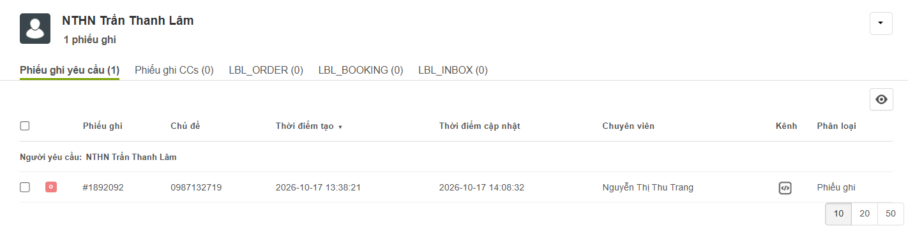
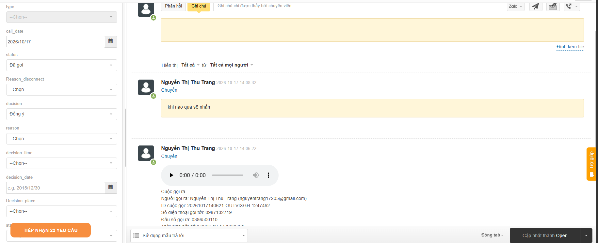
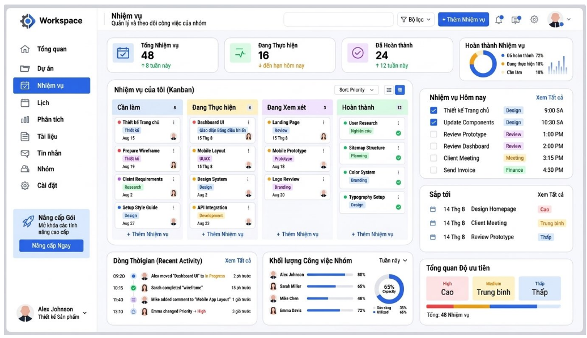
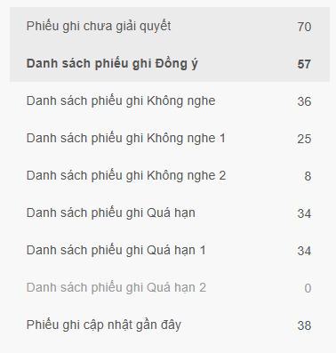
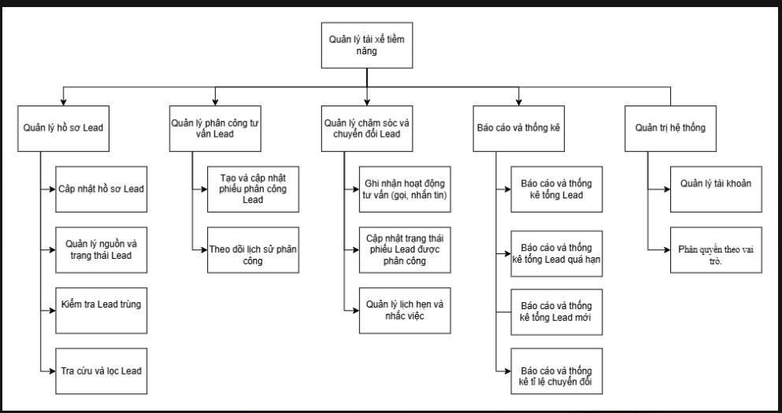
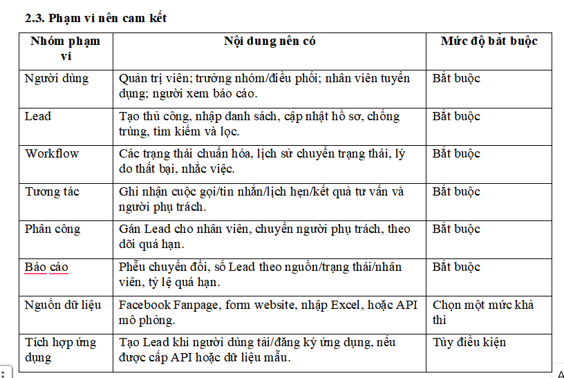
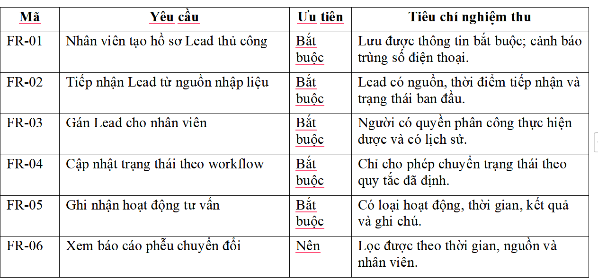
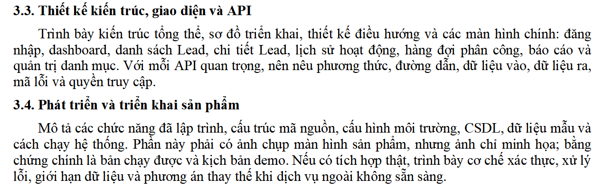

# Bản chụp nội dung Google Doc

- Tên tài liệu: Trang gửi Thảo nhen
- Đọc ngày: 20/10/2026 (Asia/Saigon).
- Nguồn: https://docs.google.com/document/d/1rMIJFe_yON1uunKA6UZ1Kie5wPEGddcJypAvm5wJBSI/edit
- Đọc bằng Google Docs connector, đủ 4 tab; 8 ảnh tải riêng và đã xem trực quan.
- Chế độ đọc: PREVIEW_WITHOUT_SUGGESTIONS; connector không trả revisionId. Đây là bản chụp tại thời điểm đọc, không tự đồng bộ thay đổi sau này.
- Giữ cách viết trong nguồn; các nhận xét và diễn giải nằm ở tài liệu note riêng. Bảng bên dưới giữ thứ tự ô, không tái tạo định dạng Word.

## quy trình làm việc

Tab ID: `t.0`

Quy trình tiếp nhận và quản lý hồ sơ Lead

Khi tài xế tiềm năng để lại thông tin qua hotline hoặc chat MXH hoặc forrm đăng ký trên website hoặc được giới thiệu bởi các tài xế cũ -> nhân viên tiếp nhận hồ sơ sẽ thu nhập thông tin, kiểm tra trùng lặp bằng số điện thoại của tài xế tiểm năng 

Nếu trùng  -> bổ sung thêm thông tin vào hồ sơ nếu có -> tổng hợp vào danh sách lead new trong ngày -> để chuyển tới trưởng nhóm Telesale để tạo phiếu phân công tư vấn cho nhân viên Telesale -> để tư vấn cho tài xế

Nếu không trùng ->  tạo hồ sơ mới cho tài xế đó (thông tin :mã hồ sơ, sdt, họ tên, thành phố đăng kí chạy xe (city: HÀ Nội, HCM,...), ngày tiếp nhận thông tin lead lần đầu (lead date), nguồn lead(lead source), Vehicle type(xe Van/ Motorbike), trạng thái Lead (Activated - đã hoàn tất đăng kí thành công/ Onboarded - đã chạy được đơn đầu tiên/ New - vẫn còn khả năng lên đăng kí/ Closed - đóng hồ sơ do không có nhu cầu đăng kí nữa/ sai sdt) -> tổng hợp vào danh sách lead new trong ngày -> để chuyển tới trưởng nhóm Telesale để tạo phiếu phân công tư vấn cho nhân viên Telesale -> để tư vấn cho tài xế.

Bộ phận tiếp nhận hồ sơ và bộ phận Telesales có quyền truy cập bộ hồ sơ này, nhưng bộ phận Telesale chỉ có quyền xem thông tin.

Quy trình phân công Lead

Trưởng nhóm Telesale nhận danh sách lead new từ bộ phận tiếp nhận hồ sơ

-> Tạo các phiếu phân công tư vấn cho các thành viên trong team để tư vấn có thông tin về : 

mã phiếu phân công

mã hồ sơ

thời gian tạo phiếu (thời điểm trưởng nhóm tạo)

thời gian cập nhật phiếu (thời điểm cuối phiếu được cập nhật bởi trưởng nhóm hoặc thành viên được phân công))

chuyên viên được phân công

Trạng thái phiếu (New/Open/Solved/Closed)

New : khi phiếu chưa được chuyên viên liên hệ

Open: khi phiếu đang được tư vấn, tài xế cần chăm sóc tiếp (số lần không nghe máy <3 lần/ đã tư vấn và có khả năng lên đăng kí trong 14 ngày kể từ ngày tạo phiếu phân công/ số lần quá hạn < 3 lần)

Solved : khi tài xế không còn cần chăm sóc tiếp bởi chuyên viên này(không còn nhu cầu/ không đủ điều kiện đăng kí/ đã hoàn tất đăng ký(Activated)/ số lần không nghe máy> 3 lần/ Quá hạn không lên đăng kí theo lịch hẹn > 3 lần) nhưng vẫn có thể mở lại phiếu về trạng thái “open” để chăm sóc tiếp trong 14 ngày kể từ ngày tạo phiếu.

Closed : trạng thái tự cập nhật sau 14 ngày kể từ ngày tạo phiếu hoặc do trưởng nhóm cập nhật -> cho thấy lead không còn thuộc quyền hạn quản lý của chuyên viên đã đc phân công nữa.

(1 lead có thể có được phân tư vấn nhiều lần bởi nhiều thành viên)

*Minh họa

Danh sách phiếu Closed hàng ngày được gửi tới bộ phận tiếp nhận hồ sơ để được cập nhật trạng thái hồ sơ Lead.

Quy trình tư vấn và theo dõi Lead

*Minh họa

 Chuyên viên Telesale tiếp nhận phiếu phân công -> ấn vào phiếu -> bắt đầu gọi điện/ nhắn tin zalo tư vấn (trên đó có bản ghi lại cuộc gọi/ phần chat + thời gian thực hiện hoạt động đó) -> cập nhật các trường thông tin của phiếu chi tiết phân công :

Call date;

Satus (New/ Đã gọi/ Không nghe máy 1/KNM 2/ KNM3/ Quá hạn 1/ Quá hạn 2/ Quá hạn 3/ Sai sdt)

Decision : Đồng ý/ Không đồng ý/ Cúp ngang/ 0

Reason (lí do không đồng ý) : Không có nhu cầu/ Tạm thời bận/ Không đủ điều kiện đăng ký/ 0

Decision Date (ngày hẹn)

Decision Place

Ghi chú 

Nhân viên Telesale có thể kiểm tra thông tin hồ sơ tài xế để theo dõi trạng thái Lead 

Thảo tham khảo giao diện nhiệm vụ của chuyên viên nhó: 

T cần nó thể hiện được các danh sách phiếu cần giải quyết kiểu bên dướ dạng mục con ở mục nhiệm vụ i, xong ấn vào cái nào là hiện ra các phiếu của mục đó(ví dụ ấn mục không nghe máy -> hiện màn hình các phiếu đó)

## BFD

Tab ID: `t.c8gv4ptck7xl`

## yêu cầu của thầy t nhó

Tab ID: `t.krrgqymy76wk`

Mô hình dữ liệu tối thiểu nên bao gồm User, Role, Lead, LeadSource, LeadStatus, Activity, Assignment, Appointment và AuditLog; có thể bổ sung bảng ImportBatch hoặc IntegrationEvent nếu có chức năng nhập/tích hợp.

Các chức năng tối thiểu

| Phân hệ | Chức năng đề nghị | Tiêu chí nghiệm thu minh họa |
|---|---|---|
| Đăng nhập và phân quyền | Đăng nhập, đổi mật khẩu, phân quyền theo vai trò. | Tài khoản không được xem/sửa chức năng ngoài quyền. |
| Dashboard | Tổng Lead, Lead mới, Lead quá hạn, tỷ lệ chuyển đổi và biểu đồ phễu. | Số liệu thay đổi đúng khi dữ liệu Lead thay đổi. |
| Quản lý Lead | CRUD, tìm kiếm, lọc, gắn nguồn, gắn nhãn, chống trùng theo số điện thoại. | Tạo và truy xuất được hồ sơ trong thời gian hợp lý. |
| Phân công | Gán Lead, nhận việc, chuyển việc, lọc theo nhân viên và hạn xử lý. | Trưởng nhóm theo dõi được Lead chưa xử lý/quá hạn. |
| Báo cáo | Lọc theo thời gian, nguồn, trạng thái, nhân viên; xuất CSV/XLSX nếu phù hợp. | Báo cáo khớp với dữ liệu chi tiết khi đối chiếu mẫu. |

## NHỜ THẢO

Tab ID: `t.ui5s7g2dk4rc`

những phần này (như API - cái này thì chắc bài t k có,  cấu trúc mã nguồn, cấu hình môi trường…)  m code có thể t không biết để hiểu được thì m note lại giúp tao nhé (m cứ đề nghị giá nhó)

