# Bản chụp Google Doc — 24/10/2026

Nguồn: https://docs.google.com/document/d/1rMIJFe_yON1uunKA6UZ1Kie5wPEGddcJypAvm5wJBSI/edit?tab=t.w3l561a07f2x

Đọc trực tiếp đủ 9 tab; NOTE SỬA là tab cha trống, yêu cầu nằm ở 4 tab con. Connector không cung cấp revisionId. Nội dung bên dưới là bản chụp chữ, không tự đồng bộ.

## quy trình làm việc

Tab ID: `t.0`.

Quy trình tiếp nhận và quản lý hồ sơ Lead
Khi tài xế tiềm năng để lại thông tin qua hotline hoặc chat MXH hoặc forrm đăng ký trên website hoặc được giới thiệu bởi các tài xế cũ -> nhân viên tiếp nhận hồ sơ sẽ thu nhập thông tin, kiểm tra trùng lặp bằng số điện thoại của tài xế tiểm năng 
Nếu trùng  -> bổ sung thêm thông tin vào hồ sơ nếu có -> tổng hợp vào danh sách lead new trong ngày -> để chuyển tới trưởng nhóm Telesale để tạo phiếu phân công tư vấn cho nhân viên Telesale -> để tư vấn cho tài xế
Nếu không trùng ->  tạo hồ sơ mới cho tài xế đó (thông tin :mã hồ sơ, sdt, họ tên, thành phố đăng kí chạy xe (city: HÀ Nội, HCM,...), ngày tiếp nhận thông tin lead lần đầu (lead date), nguồn lead(lead source), Vehicle type(xe Van/ Motorbike), trạng thái Lead (Activated - đã hoàn tất đăng kí thành công/ Onboarded - đã chạy được đơn đầu tiên/ New - vẫn còn khả năng lên đăng kí/ Closed - đóng hồ sơ do không có nhu cầu đăng kí nữa/ sai sdt) -> tổng hợp vào danh sách lead new trong ngày -> để chuyển tới trưởng nhóm Telesale để tạo phiếu phân công tư vấn cho nhân viên Telesale -> để tư vấn cho tài xế.
Bộ phận tiếp nhận hồ sơ và bộ phận Telesales có quyền truy cập bộ hồ sơ này, nhưng bộ phận Telesale chỉ có quyền xem thông tin.
Quy trình phân công Lead
Trưởng nhóm Telesale nhận danh sách lead new từ bộ phận tiếp nhận hồ sơ
-> Tạo các phiếu phân công tư vấn cho các thành viên trong team để tư vấn có thông tin về : 
mã phiếu phân công
mã hồ sơ
thời gian tạo phiếu (thời điểm trưởng nhóm tạo)
thời gian cập nhật phiếu (thời điểm cuối phiếu được cập nhật bởi trưởng nhóm hoặc thành viên được phân công))
chuyên viên được phân công
Trạng thái phiếu (New/Open/Solved/Closed)
New : khi phiếu chưa được chuyên viên liên hệ
Open: khi phiếu đang được tư vấn, tài xế cần chăm sóc tiếp (số lần không nghe máy <3 lần/ đã tư vấn và có khả năng lên đăng kí trong 14 ngày kể từ ngày tạo phiếu phân công/ số lần quá hạn < 3 lần)
Solved : khi tài xế không còn cần chăm sóc tiếp bởi chuyên viên này(không còn nhu cầu/ không đủ điều kiện đăng kí/ đã hoàn tất đăng ký(Activated)/ số lần không nghe máy> 3 lần/ Quá hạn không lên đăng kí theo lịch hẹn > 3 lần) nhưng vẫn có thể mở lại phiếu về trạng thái “open” để chăm sóc tiếp trong 14 ngày kể từ ngày tạo phiếu.
Closed : trạng thái tự cập nhật sau 14 ngày kể từ ngày tạo phiếu hoặc do trưởng nhóm cập nhật -> cho thấy lead không còn thuộc quyền hạn quản lý của chuyên viên đã đc phân công nữa.
(1 lead có thể có được phân tư vấn nhiều lần bởi nhiều thành viên)

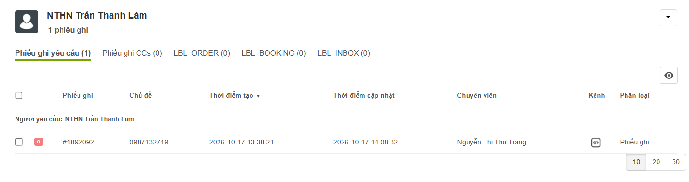

*Minh họa
Danh sách phiếu Closed hàng ngày được gửi tới bộ phận tiếp nhận hồ sơ để được cập nhật trạng thái hồ sơ Lead.
Quy trình tư vấn và theo dõi Lead

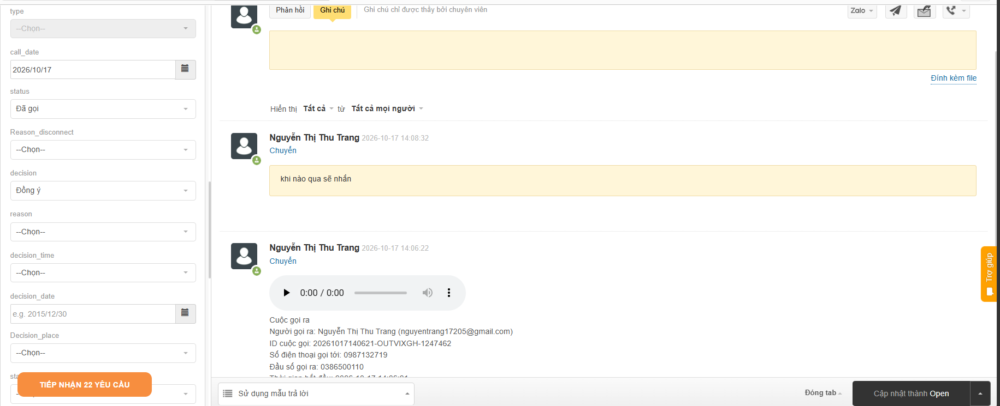

*Minh họa
 Chuyên viên Telesale tiếp nhận phiếu phân công -> ấn vào phiếu -> bắt đầu gọi điện/ nhắn tin zalo tư vấn (trên đó có bản ghi lại cuộc gọi/ phần chat + thời gian thực hiện hoạt động đó) -> cập nhật các trường thông tin của phiếu chi tiết phân công :
Call date;
Satus (New/ Đã gọi/ Không nghe máy 1/KNM 2/ KNM3/ Quá hạn 1/ Quá hạn 2/ Quá hạn 3/ Sai sdt)
Decision : Đồng ý/ Không đồng ý/ Cúp ngang/ 0
Reason (lí do không đồng ý) : Không có nhu cầu/ Tạm thời bận/ Không đủ điều kiện đăng ký/ 0
Decision Date (ngày hẹn)
Decision Place
Ghi chú 
Nhân viên Telesale có thể kiểm tra thông tin hồ sơ tài xế để theo dõi trạng thái Lead 
Thảo tham khảo giao diện nhiệm vụ của chuyên viên nhó: 

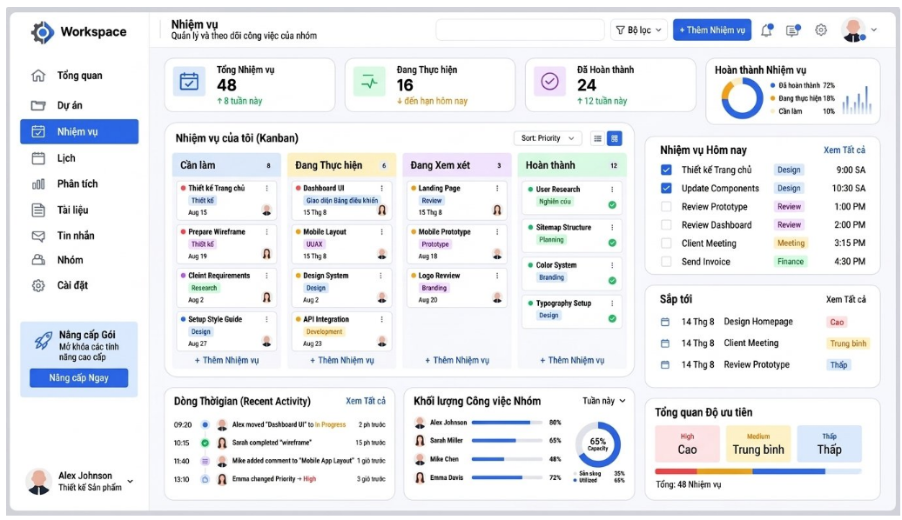

T cần nó thể hiện được các danh sách phiếu cần giải quyết kiểu bên dướ dạng mục con ở mục nhiệm vụ i, xong ấn vào cái nào là hiện ra các phiếu của mục đó(ví dụ ấn mục không nghe máy -> hiện màn hình các phiếu đó)

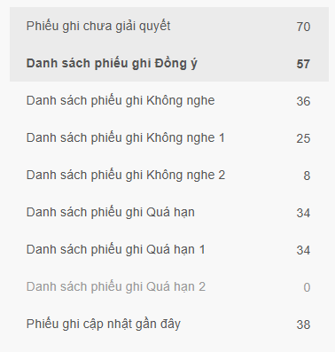

## BFD

Tab ID: `t.c8gv4ptck7xl`.

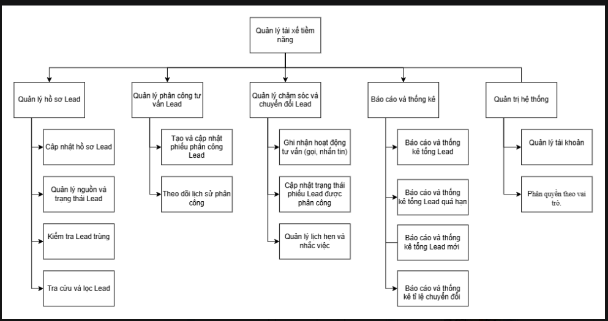

## yêu cầu của thầy t nhó

Tab ID: `t.krrgqymy76wk`.

Mô hình dữ liệu tối thiểu nên bao gồm User, Role, Lead, LeadSource, LeadStatus, Activity, Assignment, Appointment và AuditLog; có thể bổ sung bảng ImportBatch hoặc IntegrationEvent nếu có chức năng nhập/tích hợp.

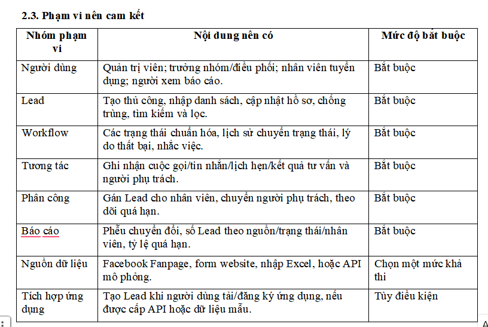

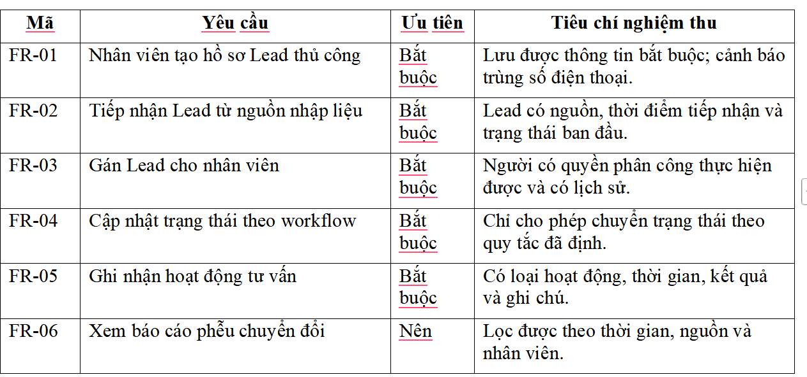

Các chức năng tối thiểu
Phân hệ
Chức năng đề nghị
Tiêu chí nghiệm thu minh họa
Đăng nhập và phân quyền
Đăng nhập, đổi mật khẩu, phân quyền theo vai trò.
Tài khoản không được xem/sửa chức năng ngoài quyền.
Dashboard
Tổng Lead, Lead mới, Lead quá hạn, tỷ lệ chuyển đổi và biểu đồ phễu.
Số liệu thay đổi đúng khi dữ liệu Lead thay đổi.
Quản lý Lead
CRUD, tìm kiếm, lọc, gắn nguồn, gắn nhãn, chống trùng theo số điện thoại.
Tạo và truy xuất được hồ sơ trong thời gian hợp lý.
Phân công
Gán Lead, nhận việc, chuyển việc, lọc theo nhân viên và hạn xử lý.
Trưởng nhóm theo dõi được Lead chưa xử lý/quá hạn.
Báo cáo
Lọc theo thời gian, nguồn, trạng thái, nhân viên; xuất CSV/XLSX nếu phù hợp.
Báo cáo khớp với dữ liệu chi tiết khi đối chiếu mẫu.

## NHỜ THẢO

Tab ID: `t.ui5s7g2dk4rc`.

những phần này (như API - cái này thì chắc bài t k có,  cấu trúc mã nguồn, cấu hình môi trường…)  m code có thể t không biết để hiểu được thì m note lại giúp tao nhé (m cứ đề nghị giá nhó)

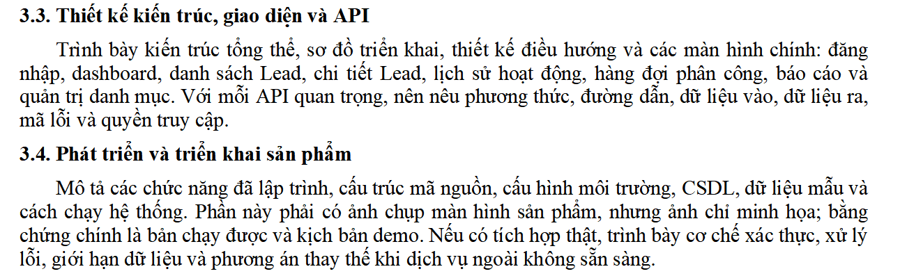

## NOTE SỬA

Tab ID: `t.w3l561a07f2x`.

## CHUYÊN VIÊN TELESALE

Tab ID: `t.a4j92hqjms9j`.

Tổng quan 

-> chuyển thành: 

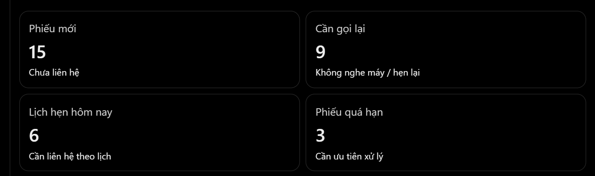

Bộ lọc thời gian: hôm nay, 7 ngày, tháng này hoặc khoảng ngày tùy chọn. 

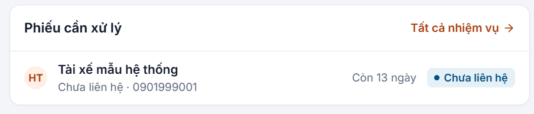

Bỏ chỗ”Chưa liên hệ” cạnh sdt nhó
Có phần lịch sử hoạt động gần đây được khum

các trường thì tương tự các phiếu trong phần nhiệm vụ nhó.
Nhiệm vụ

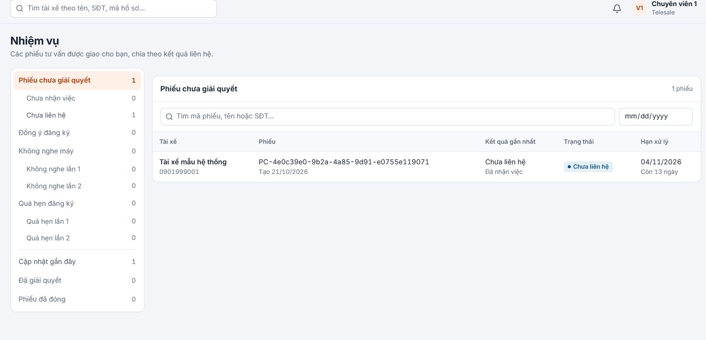

Đổi mục “Quá hạn” -> “Cần hẹn lại” nhó, và các phiếu có hẹn trong ngày 1, mà tài xế chưa được cập nhật trạng thái đã đăng ký, thì sẽ đổ phiếu về “Cần hẹn lại” vào 00:00 ngày 2 nhá. 
Các trường của 1 phiếu từ trái qua phải: Mã phiếu(m đơn giản hóa giúp t nhó), Số điện thoại, “Tài xế” đổi -> “Người yêu cầu”, Chuyên viên, Thời điểm tạo , Thời điểm cập nhật, Kết quả gần nhất(không nghe máy,đã liên hệ,...), Trạng thái phiếu Hạn xử lý.

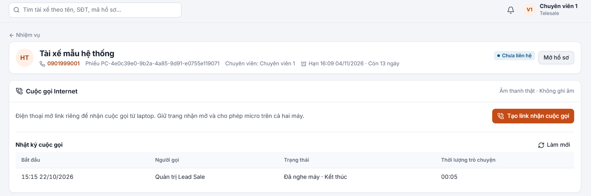

Chỗ “Tài xế mẫu hệ thống” : bỏ “mã phiếu” + “tên chuyên viên” nhó
M bỏ dúp tao mục cuộc gọi Internet nhó, t thấy phần lịch sử cuộc gọi có cai đính kèm file ghi âm, vs hình ảnh chat là uki rùi :>>>
Tương tự, bỏ cả ở “Hồ sơ tài xế” giúp tao nhé.

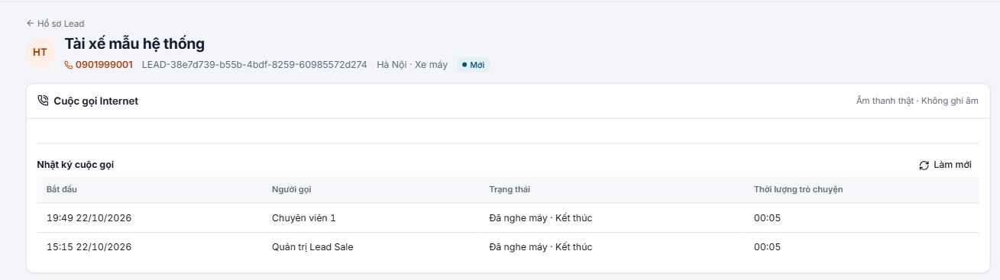

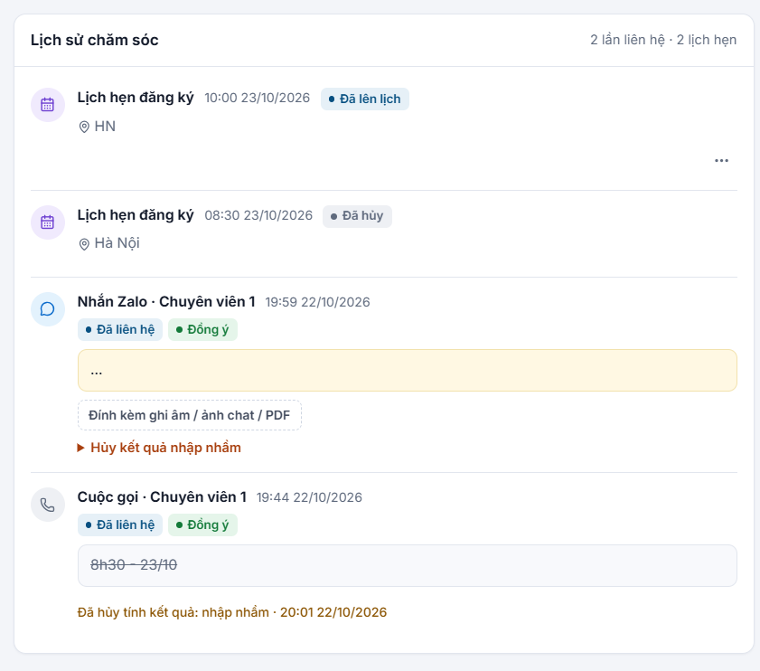

Bỏ tính năng huỷ kết quả nhập nhầm giúp tao nhó + với việc đính kèm các file ghi âm, hình ảnh chat là bắt buôc nhó.
Tách hộ t chỗ này thành 2 phần: 
1 bên là ghi chú (nhắn zalo/cuộc gọi) - 1 bên Danh sách lịch hẹn nhá.

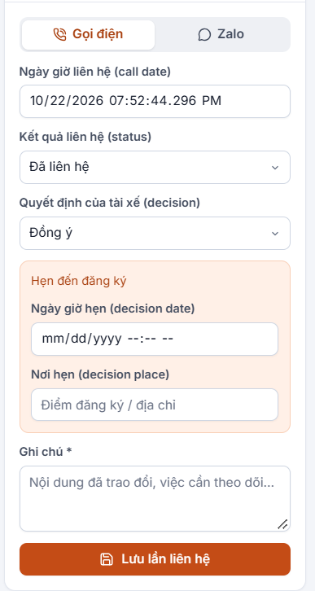

Kết quả liên hệ : thêm Activated giúp tao nhó
Chỗ nơi hẹn m để dạng list đổ xuống giúp t nhó (văn phòng HN1, văn phòng HN2, văn phòng HCM1, văn phòng HCM2, văn phòng ĐN1, văn phòng ĐN2) nhó

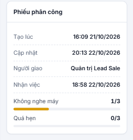

Xóa mục này dúp tao nhó

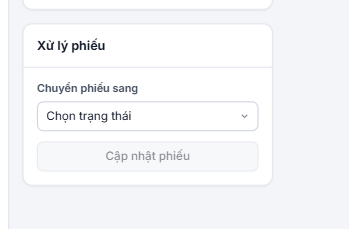

Đủ các trạng thái dúp tao nhó: Chưa liên hệ, Đang tư vấn (Đồng ý, KNM, quá hạn) và “solved” thành -> Đã giải quyết nha nha.
Bắt buộc phải cập nhật trạng thái phiếu nhó.

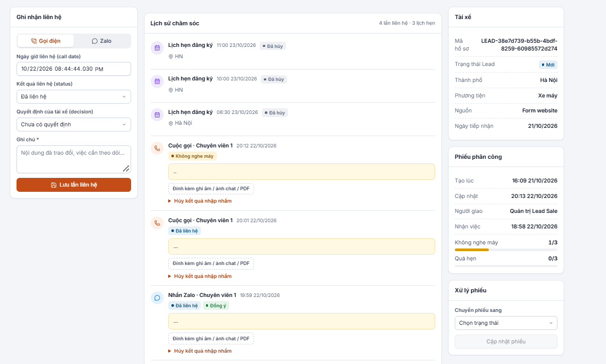

Chuyển 2 mục “tài xế” vs” xử lý phiếu” về cùng phía với “Ghi nhân liên hệ” nhó. 
Lịch hẹn

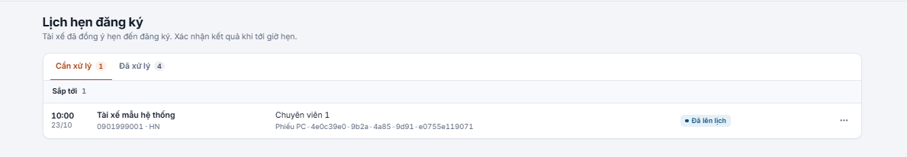

Bỏ cột “Chuyên viên 1” nhá do ở đây chỉ hiện lịch hẹn của chuyên viên 1 mò, m chia thành cột: Thời gian hẹn , Địa điểm hẹn, Tên +SDT tài xế, “Đã lên lịch” nhó.

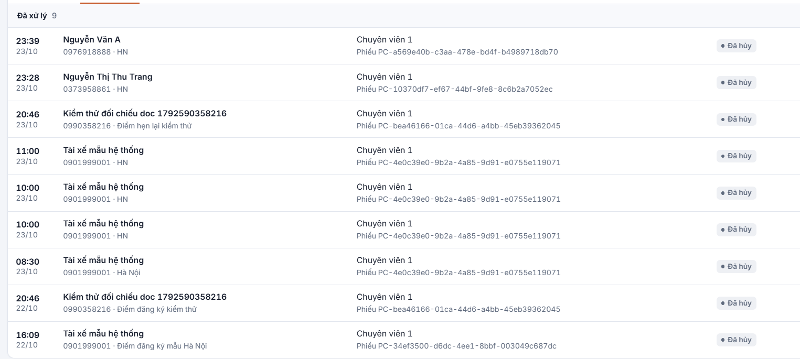

Vì kết quả của lịch hẹn phải qua ngày mới, mới được bộ phận onboard gửi file thông tin các tài xế đã lên đki thành công 
-> nên những lịch hẹn ngày 1 khi đã qua thời điểm  hẹn -> thì sẽ chuyển sang mục đã xử lý + để trạng thái là : “chờ cập nhật kết quả” -> nếu sang ngày 2 vào lúc 8h:00 AM, nếu hồ sơ tàu xế được hẹn không được cập nhật trạng thái thành”Đã đăng ký thành công” hoặc “đã chạy đơn đầu” thì lịch hẹn chuyển trạng thái “thất bại”,ngược lại thì sẽ là”thành công”.
- Còn các lịch hẹn mà bị hủy do liên hệ xế và thay đổi hẹn -> thì để trạng thái”đã hủy” nha.
Hồ sơ Lead

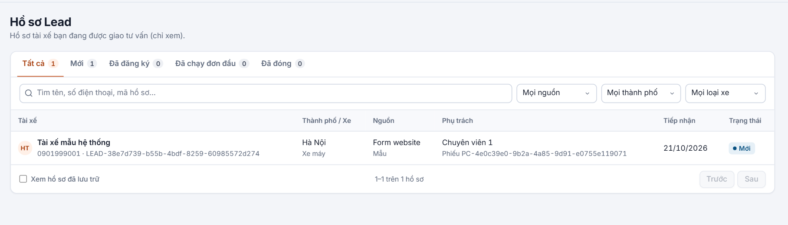

Cái lọc mọi thành phố : thêm vào list dúp tao : HCM và Đà nẵng nhó cho đồng bộ

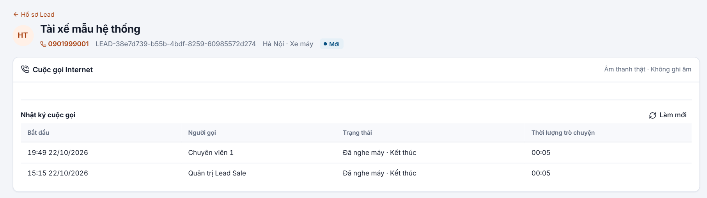

Bỏ mục cuộc gọi Internet nha
Dòng dưới tên “Tài xế mẫu hệ thống” để mỗi mã hồ sơ với tình trạng “mới” thui nhó.

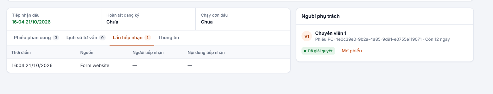

Bỏ mục “Lần tiếp nhận” nhé
ở mục thông tin thì để thành bảng giúp tao nha: để đồng bộ giao diện với bên Trưởng nhóm Lead vs nhân viên tiếp nhận hồ sơ nhen. Gồm các trường
Mã hồ sơ
SDT
Họ tên
Khu vực đăng ký
Phương tiện
Thời gian tiếp nhận hồ sơ
Nguồn Lead
Trạng thái đăng ký
Lịch sử tư vấn : sẽ là lịch sử tư vấn của tất cả các phiếu mà chuyên viên 1 từng tư vấn cho hồ sơ này nhỉ?
Bỏ mục “Người phụ trách” nhá.
Báo cáo
Chuyên viên không cần báo cáo, chỉ cần có dashboard phần tổng quan là được.

## Trường nhóm

Tab ID: `t.5sluq4kb16xk`.

Tổng quan

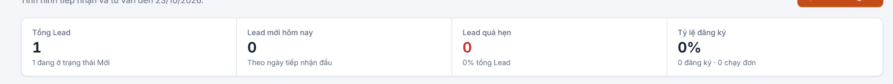

-> Chuyển thành:

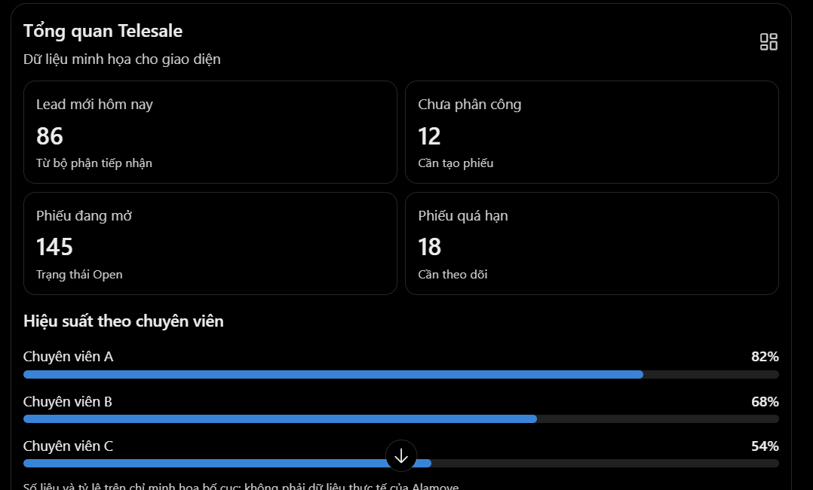

Đặt tên là “Hiệu suất chuyển đổi thành công theo chuyên viên” nha (Số lead được giao/ Số lead đã chạy đơn đầu)
Biểu đồ Lead: tỷ lệ chuyển đổi thành công theo nguồn, thành phố.
Bộ lọc thời gian: hôm nay, 7 ngày, tháng này hoặc khoảng ngày tùy chọn. 

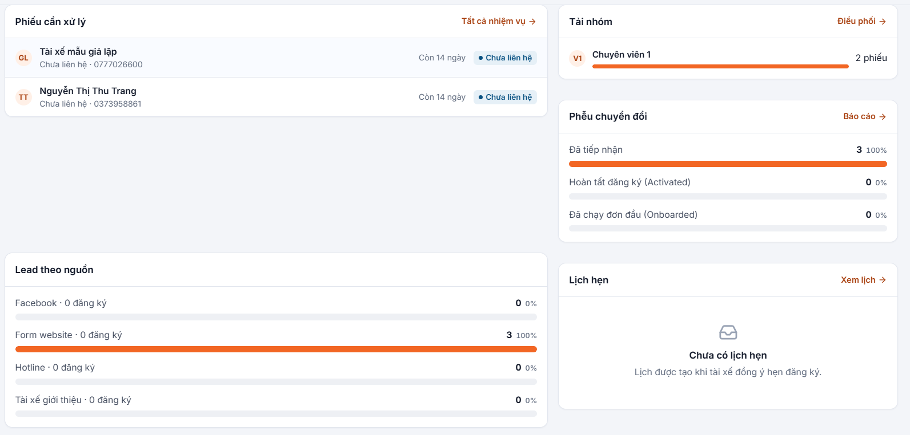

Đổi tên tải nhóm -> Số phiếu đã phân công còn tồn (Tức tất cả số phiếu đã phân công và vẫn đang mở cho tới thời điểm hiện tại, chưa Closed, m có thể nghĩ tên khác hay hơn - hiện tao thấy hình như nó chỉ thể hiện số phiếu đã phân công trong ngày thôi)
Bỏ”Phễu chuyển đổi” + bỏ “Lead theo nguồn”.
Thêm phần lịch sử hoạt động gần đây của tất cả chuyên viên(tương tự lịch sử hoạt động của bên giao diện chuyên viên, chỉ là ở đây thì thấy của tất cả)

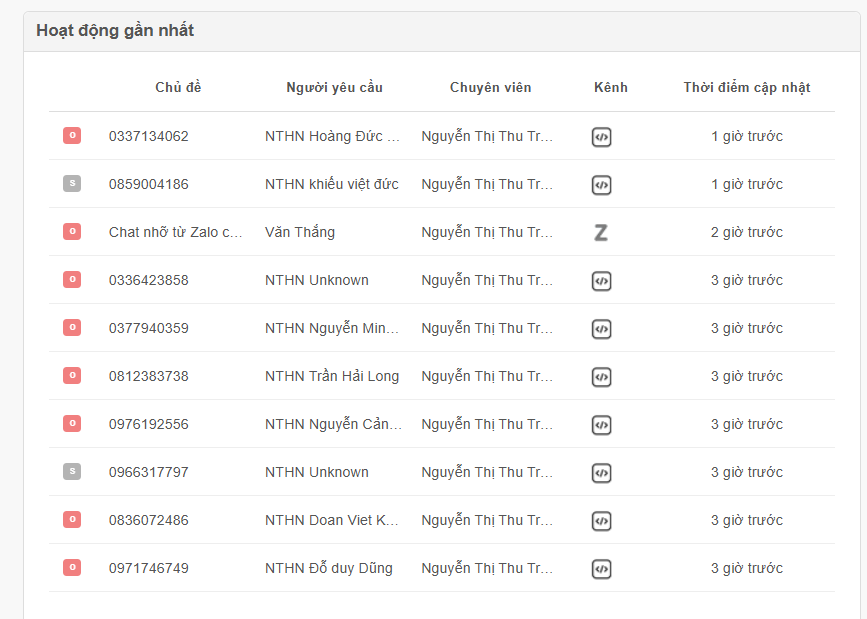

*Minh họa

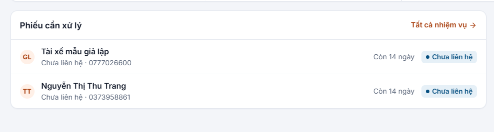

Bỏ chỗ “chưa liên hệ” cạnh sdt 
Nhiệm vụ
Tương tự, hãy chính những điều như tao đã  note bên chuyên viên nhá.

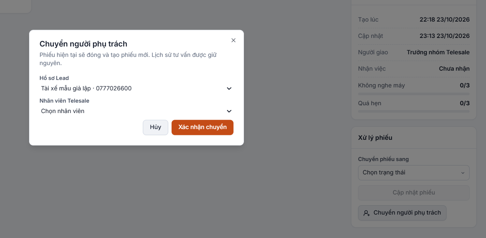

Pop up của chuyển người phụ trách : bỏ mũi tên chỗ:”hồ sơ LEad’
Chỗ chọn nhân viên thì thêm lựa chọn “ Chuyên viên 2” nhé
Điều phối

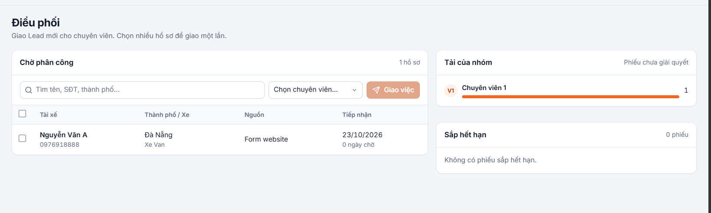

Chỗ chọn chuyên viên -> Thêm lựa chọn “chuyên viên 2” nhó 
Tương tự sửa cho tất cả những chỗ có chọn chuyên viên thì cần đủ tên 2 chuyên viên, chỗ nào chọn thành phố cần đủ (HCM, HN, Đà Nẵng)
Tương tự, sửa tên “Tải nhóm” giúp tao
Những chỗ có cột về Thời gian -> t cần có nút lọc tăng dần/ giảm dần 
Sửa thành có các cột (Mã hồ sơ, Họ tên, SDT, Thành phố, Phương tiện, Nguồn, Thời gian tiếp nhận) tương tự các cột bên Hồ sơ mà teo đã note nhó.
Lịch hẹn
Chỉnh tương tự bên “chuyên viên” nha.
Hồ sơ
Chỉnh tương tự đồng bộ giao diện với “Chuyên viên” nhó
Báo cáo (có filter theo thời gian)
*Minh họa

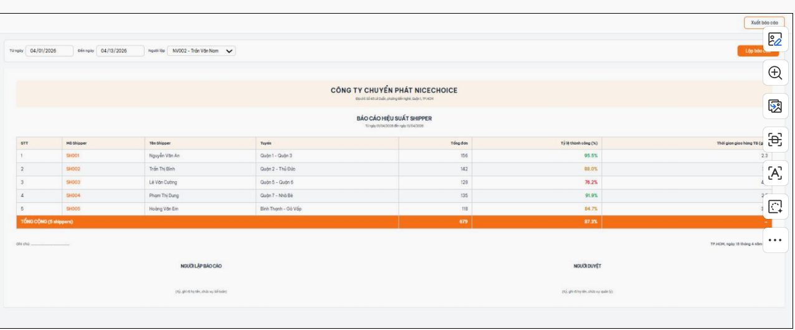

1. Báo cáo hiệu suất làm việc của chuyên viên Telesale
Số phiếu được giao cho mỗi chuyên viên.
Số phiếu chưa liên hệ.
Số phiếu đang tư vấn
Số phiếu đã giải quyết
Số phiếu đã đóng.
2. Báo cáo kết quả liên hệ và tư vấn theo từng chuyên viên
Tỷ lệ số phiếu đã liên hệ thành công 
Tỷ lệ số phiếu không nghe máy
Tỷ lệ số phiếu sai số điện thoại.
Tỷ lệ số phiếu đồng ý (số phiếu đồng ý/ tổng số phiếu)
Tỷ lệ số phiếu không đồng ý 
Tỷ lệ số phiếu cúp ngang.
3. Báo cáo tỷ lệ chuyển đổi Lead (Filter theo chuyên viên/ nguồn/thành phố & Filter thời gian)
Số Lead được tiếp nhận.
Số Lead có quyết định đồng ý đăng ký.
Tỷ lệ số Lead đạt trạng thái đã đăng ký.
Tỷ lệ số Lead đạt trạng thái đã chạy đơn đầu.

## Tiếp nhận viên

Tab ID: `t.1c2qqrsfc6jm`.

Tổng quan 

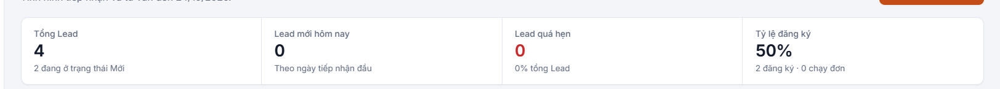

Chuyển thành các thông tin sau:

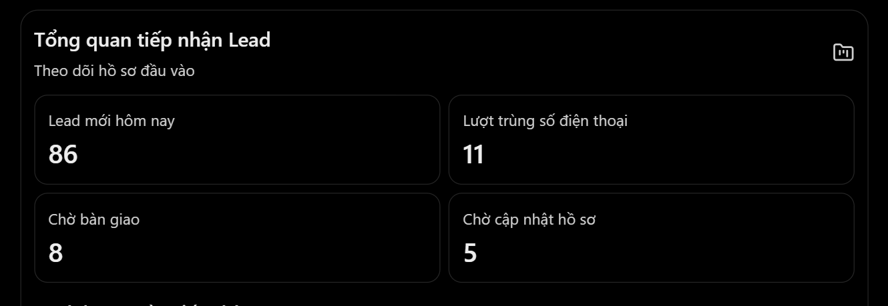

*Thay “Lượt trùng SDT” -> “Tổng số hồ sơ Lead”

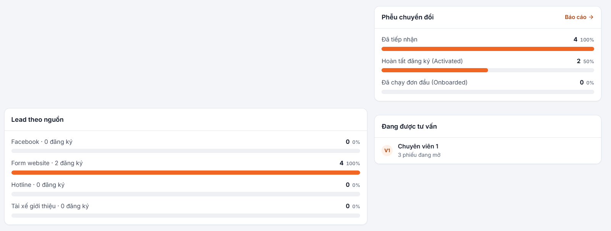

Giữ “”Đang được tư vấn”
Còn đâu chuyển thành dash như sau:

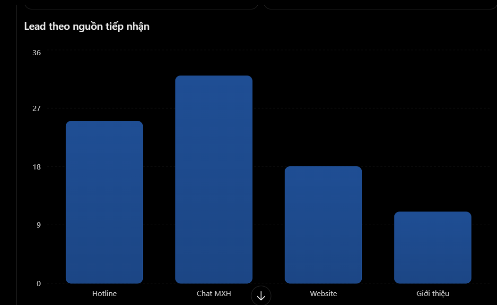

Bổ sung lịch sử cập nhật hồ sơ nha.
Bàn giao Closed 
Tương tự bên “Trưởng nhóm” nha
Hồ sơ Lead
Chỉ hiển thị thông tin của hồ sơ thôi nha, không cần thông tin về các phiếu đóng, mở, lịch sử tư vấn.
Tiếp nhận viên quan tâm phiếu closed là chỉ để cập nhật trạng thái hồ sơ : Mới hay cần chuyển thành “đã đóng” do tài xế không còn nhu cầu thui.

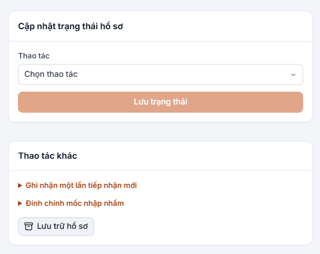

Chọn thao tác: cần đủ “mới” - đã đăng ký - đã chạy đơn đầu nha.
Bàn giao Closed

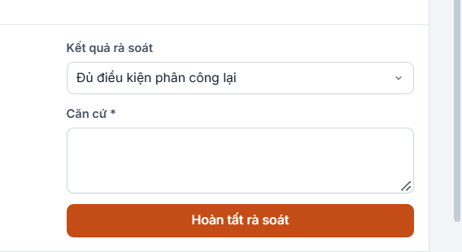

Kết quả rà soát, để 2 trạng thái thui:+ Đủ điều kiện phân công lại -> trạng thái hồ sơ “Mới”
Đóng hồ sơ -> trạng thái “Đóng”
Hộp thư 

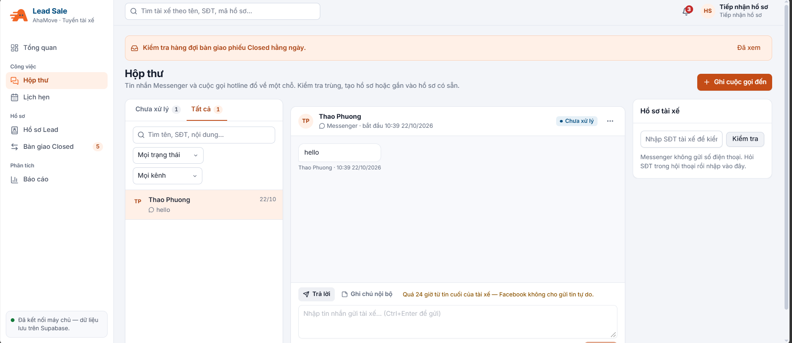

Bỏ dúp teo cũm đc nhe, tại t không mún dùng API do không hỉu.
Báo cáo (Filter thời gian)
*minh họa

1, Báo cáo tỷ trọng số hồ sơ theo nguồn tiếp nhận
Tỷ trọng hồ sơ từ hotline.
Tỷ trọng hồ sơ từ chat mạng xã hội.
Tỷ trọng hồ sơ từ form website.
Tỷ trọng hồ sơ từ tài xế cũ giới thiệu
2. Báo cáo trạng thái  hồ sơ Lead theo nguồn tiếp nhận.
Số hồ sơ .New
Số hồ sơ .Activated
Số hồ sơ .Onboarded
Số hồ sơ .Closed
Số hồ sơ có số điện thoại sai.

## Quản trị viên(Admin)

Tab ID: `t.djrpdl4wk4vs`.

các công việc của quản trị viên không liên quan tới Lead, chỉ là:  
Quản trị hệ thống
5.1. Quản lý tài khoản người dùng
Tạo tài khoản.
Cập nhật thông tin tài khoản.
Khóa hoặc mở khóa tài khoản.
Đặt lại mật khẩu.
5.2. Quản lý vai trò và phân quyền
Gán vai trò cho tài khoản.
Quy định quyền truy cập chức năng theo vai trò.
Lưu ý: Không nhất thiết phải cho Admin tự đăng ký tài khoản. Bạn có thể quy định tài khoản Quản trị viên đầu tiên được khởi tạo ra khi triển khai hệ thống, sau đó Quản trị viên đăng nhập để tạo ra tài khoản cho những người dùng khác.

